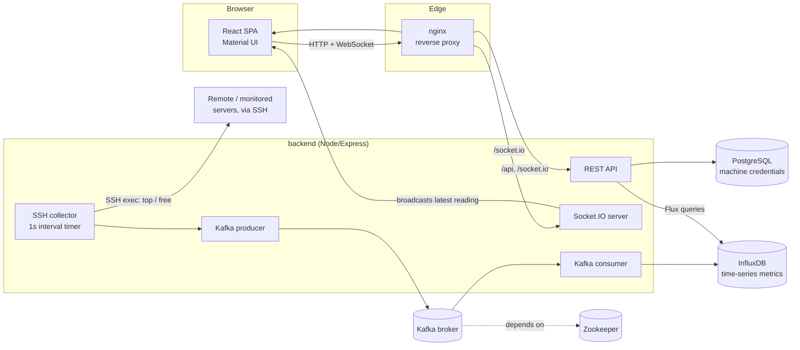
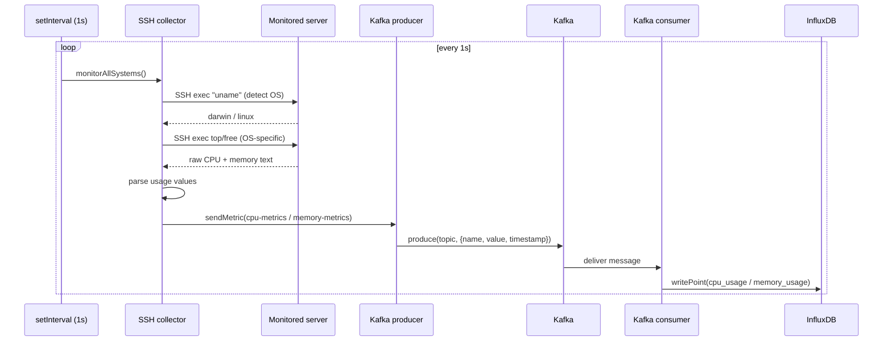
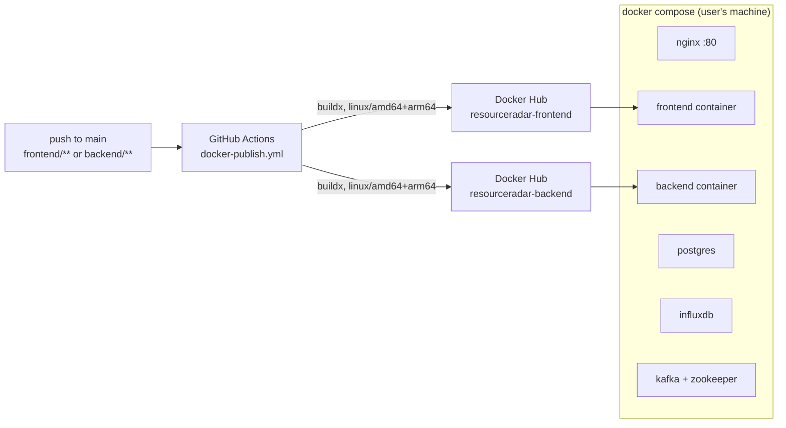

# ResourceRadar

A self-hosted dashboard that connects to remote servers over SSH, samples CPU and memory usage on an interval, and streams the results to a browser in real time.

**Status: Completed.** Built solo between November 2023 and March 2025. The full pipeline (SSH collection, Kafka transport, InfluxDB storage, WebSocket push to the frontend, multi-arch Docker images) works end to end and the last commits were about packaging it for distribution (arm64 builds, a one-line setup script). It is not under active development now.

No screenshots ship in this repository. An earlier revision briefly included some (see `git log -- Images_for_tutorial`) and a later commit added placeholder image references to this README that were never filled in; both are gone from the current tree. Real screenshots are a known gap, tracked in Known Limitations below.

## Problem

Checking whether a handful of personal or lab machines are under load usually means SSH-ing into each one and running `top` or `free` by hand. ResourceRadar automates that: point it at a list of hosts (hostname, SSH user/password, port) and it polls each one on a fixed interval, stores the history, and shows live and historical CPU/memory in one dashboard instead of N terminal tabs.

## Core functionality

- Add/edit/remove monitored machines through a form; SSH connectivity is verified before a machine is saved.
- A backend timer re-polls every registered machine once per second over SSH, running `top`/`free` (or the macOS equivalents) and parsing the output.
- Metrics are pushed onto Kafka topics, consumed, and written into InfluxDB as time series.
- The dashboard receives live updates over a Socket.IO WebSocket instead of polling the API from the browser.
- A detail view per machine queries InfluxDB for a selected time range (1 minute to 30 days) and renders it with Chart.js/Recharts.
- Machines that fail to respond are marked offline rather than dropped silently.
- A `testing/` harness spins up 10 disposable SSH-accepting containers with different resource limits, so the dashboard can be exercised without real remote hosts.

## Architecture



**Component choices, as implemented:**

- **React + Material UI frontend** — dashboard cards, an "add machine" form, and a per-machine detail view with Chart.js/Recharts time-series graphs. Dark/light mode toggle.
- **Express backend** — one process holds the REST API, the Socket.IO server, the SSH polling loop, and the Kafka producer/consumer. There's no separate collector service; `docker-compose.yml` runs it as a single `backend` container.
- **PostgreSQL** — stores machine records (`name, host, username, password, port`) in a single `machines` table (`init.sql`). This is config data, not metrics.
- **Kafka (+ Zookeeper)** — the collector publishes each CPU/memory reading to a `cpu-metrics` / `memory-metrics` topic instead of writing to InfluxDB directly; a consumer in the same backend process reads those topics and writes points into InfluxDB. This decouples collection from storage and gives the collector somewhere to hand off readings even if InfluxDB writes are momentarily slow. It also means a single-server deployment now runs a broker and a coordination service (Zookeeper, not KRaft) to support what is currently one consumer.
- **InfluxDB** — the actual time-series store, queried with Flux for both the live dashboard values (`range(start: -5m) |> last()`) and the historical graphs.
- **nginx** — reverse proxy in front of the frontend and backend containers, terminating on port 80 and also exposing InfluxDB's UI on 8086.

## Metrics ingestion pipeline



Failure handling that's actually in the code:

- SSH connection errors retry with exponential backoff (up to 5 attempts, capped at 60s) per machine, independently of the others.
- If a shell command produces no output, the collector reports `0` for that reading rather than leaving a gap or crashing the polling loop.
- The Kafka producer and consumer track their own connection state and reconnect on disconnect; if Kafka is unreachable, the collector logs and skips the metric instead of blocking.
- The dashboard marks a machine `offline` if fetching its resource usage throws.
- InfluxDB writes are batched (`flushInterval: 1000`) and force-flushed periodically, so there's a small window where a just-collected point isn't queryable yet.

Retention: InfluxDB has no explicit retention policy configured anywhere in this repo (bucket is created with defaults), so metric history is effectively unbounded unless the operator sets one manually. **Needs owner confirmation** if a retention policy was ever set outside the repo.

## Real-time dashboard flow

The dashboard doesn't poll the backend. On connect, the frontend opens a Socket.IO WebSocket; the backend's same 1-second timer that drives collection also re-queries InfluxDB for the latest value per machine and `io.emit`s it to every connected client. The per-machine detail view sends a `getGraphData` socket event (host + time range) and gets back a Flux query result for that window; there's also a REST fallback (`POST /data/graph`) for the same query.

## Deployment



`docker-compose.yml` builds images locally from source; `docker-compose-hub.yml` instead pulls the prebuilt `prajitviswanadha/resourceradar-frontend`/`-backend` images from Docker Hub, published by the `.github/workflows/docker-publish.yml` GitHub Action on every push to `main` that touches `frontend/`, `backend/`, or the workflow itself. `docker-publish.sh` does the same build/push locally with `docker buildx`. `setup-resourceradar.sh` downloads `nginx.conf`, `init.sql`, and `docker-compose-hub.yml` for a no-clone quick start.

## Setup

Requires Docker and Docker Compose.

```bash
git clone https://github.com/V-prajit/ResourceRadar.git
cd ResourceRadar
docker-compose up -d
```

Then open `http://localhost`. First startup takes a minute while Kafka, Postgres, and InfluxDB initialize.

The compose files currently hardcode the Postgres password and the InfluxDB admin token as plaintext environment values in `docker-compose.yml` / `docker-compose-hub.yml` rather than reading them from `.env` or Docker secrets — see Known Limitations. If you deploy this anywhere beyond a local/throwaway environment, replace those with your own values first:

```bash
# example values to override, not real secrets
PGPASSWORD=<your_postgres_password>
INFLUX_TOKEN=<your_influxdb_admin_token>
DOCKER_INFLUXDB_INIT_PASSWORD=<your_influxdb_password>
```

### Adding a machine to monitor

In the dashboard, click "Add Machine" and supply a name, host/IP, SSH username, SSH password, and port (default 22). The backend verifies the SSH connection before saving.

### Local development (without Docker)

```bash
cd backend && npm install && npm run dev   # needs Kafka, Postgres, InfluxDB reachable
cd frontend && npm install && npm start
```

## Testing

There's no automated test suite (`backend/package.json`'s `test` script is the CRA/npm placeholder). What exists instead is a manual integration harness in `testing/`: `run-test-environment.sh` starts 10 disposable SSH-accepting containers with different CPU/memory limits on the same Docker network as the app, `stress-test-systems.sh` generates load on them so the graphs show variation, and `cleanup-test-environment.sh` tears it down. Useful for exercising the multi-machine dashboard and for producing screenshots, but it is not a CI-run test suite — the only GitHub Actions workflow in this repo builds and publishes Docker images, it doesn't run tests.

## Known limitations

- **SSH auth is password-based, not key-based**, and machine credentials (including the SSH password) are stored **in plaintext** in the `machines` Postgres table (`init.sql` defines no encryption; `postgres_connect.js` writes/reads the raw value). This is materially weaker than "secure SSH authentication" might imply — it relies entirely on SSH's own transport encryption and on the Postgres database itself being secured, with no additional encryption at rest for saved credentials.
- The InfluxDB admin token and the Postgres password are hardcoded directly in `docker-compose.yml` and `docker-compose-hub.yml`, committed to this public repository, rather than sourced from `.env`/secrets. Anyone deploying from these files as-is is using publicly known credentials.
- No automated tests; the `testing/` directory is a manual load-generation harness, not a CI suite.
- No InfluxDB retention policy is configured in the repo, so storage grows unbounded by default.
- Kafka + Zookeeper run as a broker/coordinator pair for what is currently a single producer and a single consumer in one backend process — real throughput headroom for multiple collectors, but it's infrastructure the current single-process design doesn't need to prove out yet.
- No screenshots or hosted demo are included; see below.

## Missing media

No dashboard or detail-view screenshots exist in the repository (an earlier commit removed some, a later one added broken image references that were never filled in). Needs owner to add real screenshots, or a short recording, if this is meant to be demoed from the README.

## Personal contribution

Solo project — I designed and built all of it: the SSH collector and OS-detection logic, the Kafka producer/consumer wiring, the InfluxDB read/write paths, the Postgres machine store, the Express API and Socket.IO layer, the React/Material UI frontend, the Docker Compose topology, the multi-arch GitHub Actions publish workflow, and the manual test harness.

## License

No `LICENSE` file is present in this repository (recommend the owner add one — code is currently unlicensed, which by default means all rights reserved).
